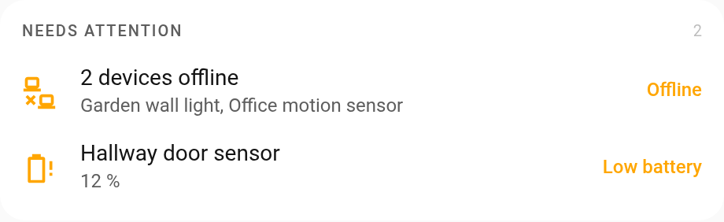
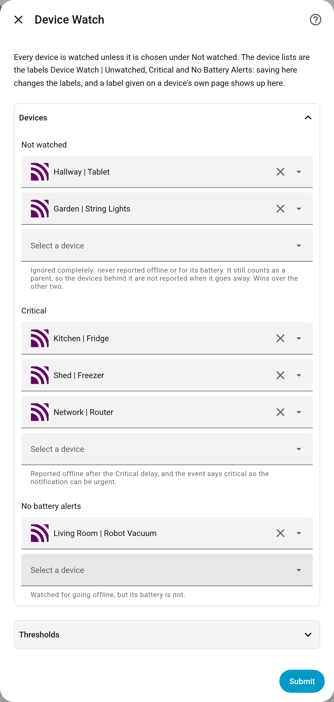

# Device Watch

[](https://hacs.xyz/docs/faq/custom_repositories/)
[](LICENSE)

Tells you which device dropped off the network or needs a new battery, by its
own name, and doesn't forget the devices you add next month.

<picture>
  <source media="(prefers-color-scheme: dark)" srcset="images/device-watch-events-dark.png">
  
</picture>

Device Watch reads the device registry instead of a list you keep up to date, so
a device added tomorrow is watched tomorrow. It decides what counts and when,
and then fires an event and updates two sensors. How you hear about it (a phone
notification, a dashboard, both) is an automation of your own; there is an
[example](#example-automation) below.

The picture above is the [Home Events](https://github.com/Sandolution/ha-home-events)
card reading Device Watch's two sensors. Any card that shows a sensor and its
attributes will do.

## Installation

### HACS

1. In HACS, open the menu (⋮) > **Custom repositories**.
2. Add `https://github.com/Sandolution/ha-device-watch` with the type **Integration**.
3. Install **Device Watch** and restart Home Assistant.
4. Go to **Settings > Devices & services > Add integration** and pick
   **Device Watch**. There is nothing to fill in.

### Manual

1. Copy `custom_components/device_watch` from this repository into
   `config/custom_components/`.
2. Restart Home Assistant.
3. Add it under **Settings > Devices & services > Add integration**.

## What counts

**Watched devices:** every device in the registry, except service devices
(integrations that show up as a device), disabled devices, and devices labelled
**Device Watch | Unwatched**.

**Offline:** a device is offline when all of its own entities are
`unavailable`. *Own* means coming from the device's own integration: entities
that other integrations hang on a device, like Powercalc's or utility_meter's,
keep their state when the device is gone, so they don't count. On a device that
others name as their parent (`via_device`), such as the Zigbee2MQTT bridge, a
`connectivity` sensor reading `off` counts as unavailable too.

**When it is reported:**

- after 15 minutes offline, or 5 for a device labelled **Device Watch | Critical**;
- not while its parent is offline. Once the parent is back, the device gets its
  own delay again, so a Zigbee2MQTT restart doesn't report eighty devices;
- devices that reach their delay within 2 minutes of each other are reported
  together, as one group;
- a reported device is back as soon as one of its own entities has a state again.

**Low battery:** any `battery` entity on the device (from any integration) below
20 % for an hour, or a battery `binary_sensor` that is `on` for an hour. It is
cleared above 30 %, which means a new battery rather than a reading wobbling
around 20 %. A battery isn't judged while its device is offline.

**Restarts:** what has been reported is kept, so a restart neither repeats a
report nor forgets one. Nothing is judged in the first 5 minutes after Home
Assistant starts, while MQTT devices are still coming back.

## Configuration

Everything is under **Configure** on the integration, in two sections: which
devices are treated differently, and the thresholds. Adding the integration
asks nothing. Changes apply without a restart.

<picture>
  <source media="(prefers-color-scheme: dark)" srcset="images/device-watch-options-dark.png">
  
</picture>

### Devices

Every device is watched for going offline and for its battery, with the normal
delay, unless it is chosen in one of these lists:

| List | Effect |
|---|---|
| Not watched | The device is ignored completely. It still counts as a parent for the devices under it. Wins over the other two. |
| Critical | Offline after the Critical delay instead of the normal one, and marked `critical: true` in the offline event. |
| No battery alerts | The device is watched for going offline; its battery is not. |

Each list is a label: **Device Watch | Unwatched**, **Device Watch | Critical**
and **Device Watch | No Battery Alerts**. Saving the dialog gives and takes away
those labels, and a label given on a device's own page shows up in the dialog,
so the two never disagree. Device Watch creates the labels when it starts, if
they don't exist yet.

Use Not watched for things that are off by design: a wall tablet that sleeps, a
seasonal light, a module that loses power with its plug.

### Thresholds

| Option | Values | Default | What it does |
|---|---|---|---|
| Offline after | 1 to 1440 minutes | 15 | How long every own entity of a device has to be unavailable before it is reported. |
| Offline after (Critical) | 1 to 1440 minutes | 5 | The same, for devices labelled Device Watch \| Critical. |
| Battery low below | 1 to 99 % | 20 | A battery level below this counts as low. |
| Battery low for | 0 to 1440 minutes | 60 | How long it has to stay low before it is reported. `0` reports it at once. |
| Battery cleared above | 2 to 100 % | 30 | A reported battery is cleared once its level is above this. Has to be higher than *Battery low below*. |
| Group window | 0 to 60 minutes | 2 | Devices that reach their delay within this window of the first one are reported together. With `0`, only devices that reach their delay in the same half minute are grouped. |

## Sensors

| Entity | State | Attributes |
|---|---|---|
| `sensor.system_device_watch_offline` | how many devices are reported offline | `devices`, `names`, `title`, `detail` |
| `sensor.system_device_watch_battery_low` | how many devices have a reported low battery | `devices`, `names`, `title`, `detail` |

| Attribute | What it holds |
|---|---|
| `devices` | a list of the devices, with the fields listed under [Events](#events) |
| `names` | their names, joined with commas |
| `title` | the device's name when there is one, "3 devices offline" or "3 low batteries" when there are more |
| `detail` | the names when there are several; for a single low battery, its level ("12 %"); otherwise empty |

`title` and `detail` are there so a dashboard card can show a sensor as one
line without a template.

The Home Events card can open `devices` into a row per device instead, each
with its own area and offline time; a tap on one opens the device. The event
behind the picture above:

```yaml
devices_offline:
  include: {entities: [sensor.system_device_watch_offline]}
  conditions: [{condition: numeric_state, above: 0}]
  category: alerts
  severity: attention
  group: entries
  entries: {attribute: devices, time: since}
  always_group: true
  title: {many: Devices offline}
  status: {each: Offline, many: "{n}"}
  icon: mdi:lan-disconnect
```

## Events

| Event | Data |
|---|---|
| `device_watch_offline` | `group_id`, `devices` (a list), `count` (how many), `critical` (`true` when any of them is Critical) |
| `device_watch_online` | `group_id`, `device` (the one that is back), `remaining` (the devices of that group still offline) |
| `device_watch_battery_low` | `device` |
| `device_watch_battery_ok` | `device` |

A device in an offline or online event has `device_id`, `name`, `area`, `since`
(when it went offline), `critical` and `battery_level` (the last known level, or
`null`). A device in a battery event has `device_id`, `name`, `area`, `since`
(when it went low), `entity_id` (the battery entity) and `level` (`null` for a
battery `binary_sensor`).

### Example automation

One phone notification per group, updated as devices come back and cleared with
the last one. Replace `notify.mobile_app_phone` with your own.

```yaml
- alias: Device Watch - Notify
  triggers:
    - trigger: event
      event_type: device_watch_offline
      id: offline
    - trigger: event
      event_type: device_watch_online
      id: online
    - trigger: event
      event_type: device_watch_battery_low
      id: battery_low
  actions:
    - variables:
        data: "{{ trigger.event.data }}"
        offline: "{{ data.devices if trigger.id == 'offline' else data.remaining | default([]) }}"
    - choose:
        - conditions: "{{ trigger.id in ['offline', 'online'] and offline | count > 0 }}"
          sequence:
            - action: notify.mobile_app_phone
              data:
                message: >-
                  {{ offline[0].name }} is offline.
                  {{ offline | count }} devices are offline:
                  {{ offline | map(attribute='name') | join(', ') }}.
                data:
                  tag: "device_watch_{{ data.group_id }}"
        - conditions: "{{ trigger.id == 'online' }}"
          sequence:
            - action: notify.mobile_app_phone
              data:
                message: clear_notification
                data:
                  tag: "device_watch_{{ data.group_id }}"
        - conditions: "{{ trigger.id == 'battery_low' }}"
          sequence:
            - action: notify.mobile_app_phone
              data:
                message: "{{ data.device.name }} battery level is at {{ data.device.level | round(0) | int }} %."
  mode: queued
```

## When something doesn't arrive

The WebSocket command `device_watch/status` (admin only) lists every device
Device Watch looked at: whether it is watched and if not why, whether it is
offline and since when, whether that was reported, and its battery entity and
level. The quickest way to read it is the browser's own console, on any Home
Assistant page:

```js
await document.querySelector("home-assistant").hass.callWS({ type: "device_watch/status" })
```

[SPEC.md](SPEC.md) has the reasoning behind each rule.

## Requirements

Home Assistant 2024.12 or newer.

## License

[MIT](LICENSE). Built with [Claude Code](https://claude.com/claude-code).
